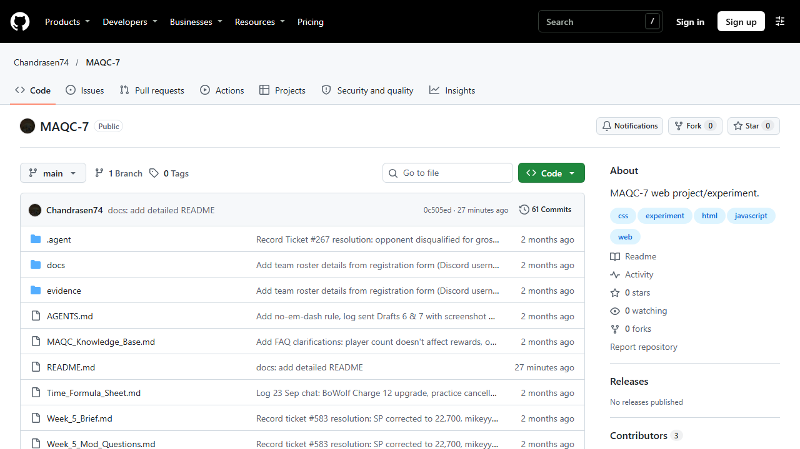

# MAQC-7

**Repository:** https://github.com/Chandrasen74/MAQC-7



## Overview
`MAQC-7` is a HTML project.
- **Primary language:** HTML
- **Languages detected:** HTML
- **Stack/tech:** HTML

## Language & stack details
- Languages: HTML
- Frameworks/tools/libraries: HTML

## How to install & run
### Prerequisites
- A modern web browser
- (Optional) [Python 3](https://www.python.org/) or any static file server for local serving

### Run locally
```bash
git clone https://github.com/Chandrasen74/MAQC-7.git
cd MAQC-7
```
- **Option 1:** open `index.html` directly in your browser
- **Option 2:** serve locally (recommended for some JS features):
```bash
python -m http.server 8000
# then open http://localhost:8000
```

## Repository structure (top-level/sample)
- `.agent/MEMORY.md`
- `.agent/PLANS.md`
- `.agent/SOUL.md`
- `.agent/USER.md`
- `AGENTS.md`
- `MAQC_Knowledge_Base.md`
- `README.md`
- `Time_Formula_Sheet.md`
- `Week_5_Brief.md`
- `Week_5_Mod_Questions.md`
- `Week_6_Brief.md`
- `Week_6_Mod_Questions.md`
- `docs/Season_Overview.md`
- `docs/Week_1.md`
- `docs/Week_2.md`
- `docs/Week_3.md`
- `docs/Week_4.md`
- `docs/Week_5.md`
- `docs/Week_6.md`
- `evidence/AI_Session_Handoff_W1_era.md`
- `evidence/Discord_Admin_Announcements_and_Rulebook.txt`
- `evidence/Discord_Community_Channel_2026-08-14_to_2026-08-30.html`
- `evidence/Earlier_Chat_Export_W2-W4_drafts.txt`
- `evidence/MAQC_Information_Guide_v1.0.pdf`
- `evidence/MAQC_S7_Team_Information_Responses.xlsx`
- `evidence/MAQC_S7_Team_Registration_Responses.csv`
- `evidence/MAQC_S7_Week1_Matchmaking.pdf`
- `evidence/MAQC_S7_Week2_Matchmaking.pdf`
- `evidence/MAQC_S7_Week3_Matchmaking.pdf`
- `evidence/MAQC_S7_Week4_Matchmaking.pdf`
- `evidence/MAQC_S7_Week5_Matchmaking.pdf`
- `evidence/MAQC_S7_Week6_Matchmaking.pdf`
- `evidence/MAQC_Session_Handoff_Update_STALE.md`
- `evidence/Screenshot_20260829_125550_Discord.jpg`
- `evidence/Screenshot_20260829_151028_Discord.jpg`
- `evidence/Screenshot_20260829_213012.png`
- `evidence/Screenshot_20260829_213403.png`
- `evidence/Screenshot_20260829_213505.png`
- `evidence/Screenshot_20260830_102725_Discord.jpg`
- `evidence/Screenshot_20260910_074204_Discord.jpg`
- ... and 8 more file(s)

## Status
Documented with screenshot, language/stack details, and setup instructions as part of a profile-wide README update.
